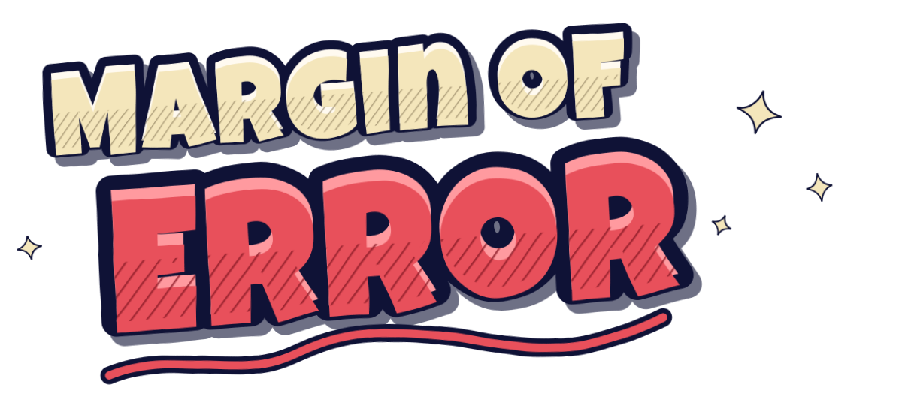
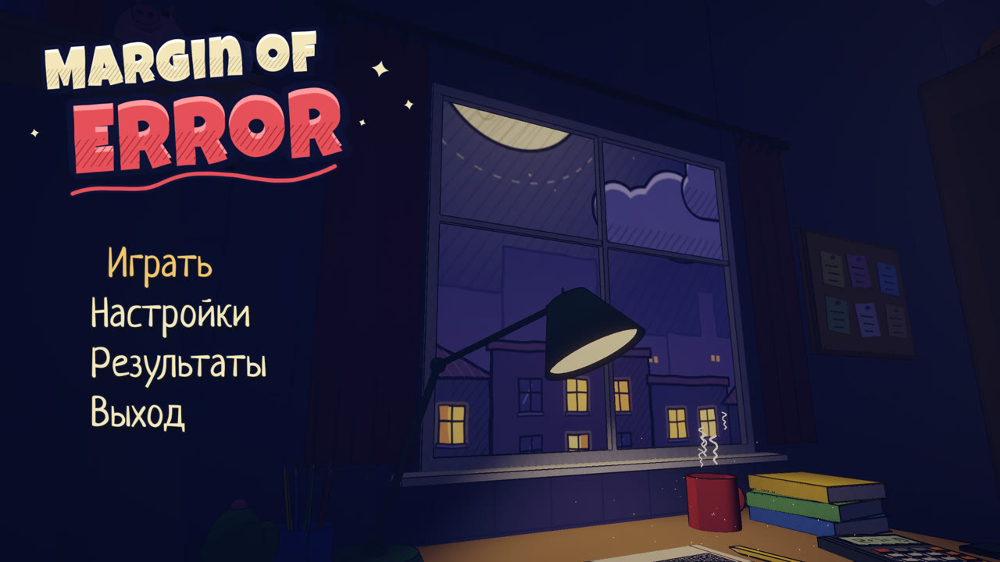
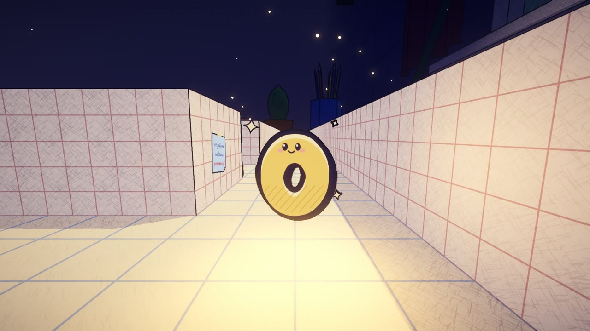
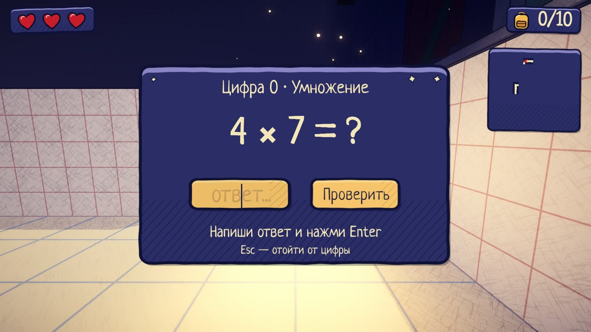
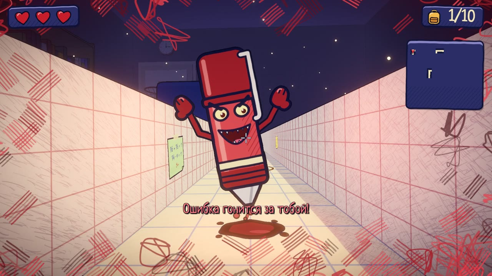
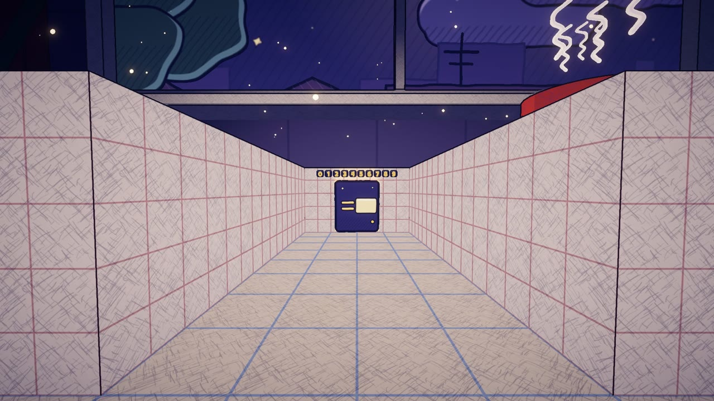
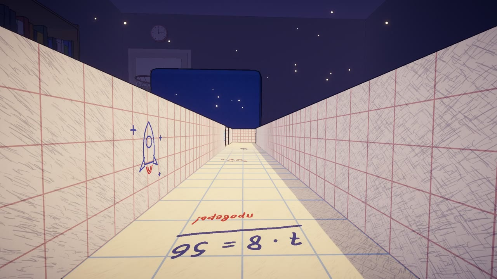
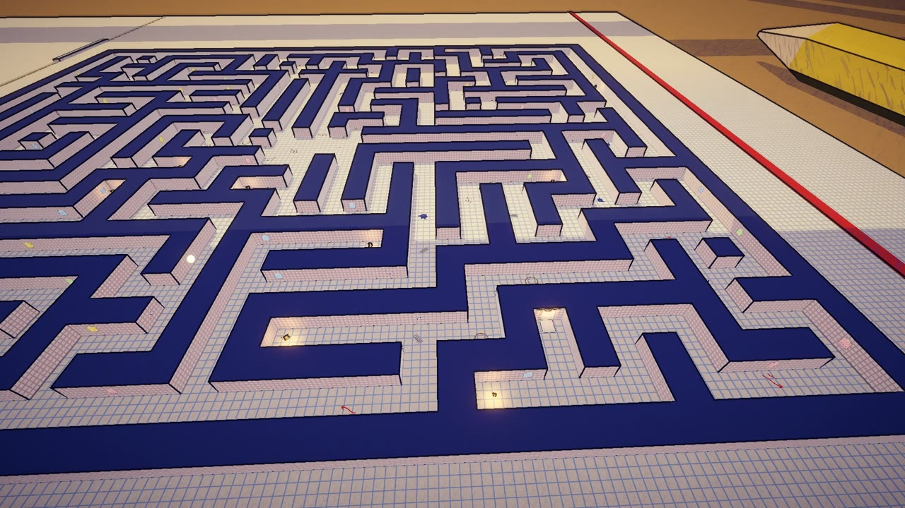

### Компьютерная игра для тренировки счёта

Ты стал совсем крошечным и попал внутрь тетради по математике. 
Собери 10 цифр, реши примеры — и не дай «Ошибке» себя догнать!

[**⬇ Скачать для Windows**](https://github.com/LotWyx/MarginOfError/releases/latest)

---

## Об игре

Ночь. На столе под лампой лежит тетрадь по математике. Её клетки стали плитками пола, линии — стенами лабиринта, а ошибки, которые учитель обводит красной ручкой, ожили.

Игрок ходит по лабиринту от первого лица и ищет **10 цифр-огоньков**. Чтобы поймать цифру, нужно решить пример. Ошибся — за тобой погонится **«Ошибка»**, красная ручка учителя, и с каждой ошибкой она становится быстрее. Когда все цифры собраны, открывается выход — дверь со знаком **«=»**: реши последний пример, и равенство станет верным.

Название — игра слов: *margin* — поля тетради, *error* — ошибка, а *margin of error* в математике означает «погрешность».

<table>
<tr>
<td width="50%"> <b>Цифра-огонёк.</b> Подойди и нажми E, чтобы её поймать</td>
<td width="50%"> <b>Карточка с примером.</b> Верный ответ — цифра в рюкзаке</td>
</tr>
<tr>
<td> <b>Погоня.</b> Красные каракули по краям — «Ошибка» близко</td>
<td> <b>Выход «=».</b> Над дверью загораются собранные цифры</td>
</tr>
<tr>
<td> <b>Лабиринт-тетрадь.</b> Каракули, стикеры, кляксы и примеры на полу</td>
<td> <b>Каждая игра — новый лабиринт</b> на странице в клетку</td>
</tr>
</table>

## Как играть

| Клавиша | Действие |
|---|---|
| <kbd>W</kbd> <kbd>A</kbd> <kbd>S</kbd> <kbd>D</kbd> / стрелки | ходить |
| мышь | осматриваться |
| <kbd>Shift</kbd> | бежать (пока хватает выносливости) |
| <kbd>E</kbd> | поймать цифру / осмотреть выход |
| <kbd>Enter</kbd> | отправить ответ |
| <kbd>Esc</kbd> | пауза, настройки, выход в меню |

- ❤️ ❤️ ❤️ — три жизни. Догнала «Ошибка» — минус сердечко и возврат на старт, но собранные цифры остаются.
- 🗺️ Карта в углу экрана открывается там, где ты уже прошёл. Когда остаётся одна-две цифры, карта подскажет район.
- ✍️ Ответ можно писать с запятой или точкой: `6,5` и `6.5` — одно и то же.

## Примеры

Цифры можно собирать в любом порядке, а примеры усложняются с каждой пойманной цифрой. Числа каждый раз новые.

| Собрано | Тема | Пример |
|:---:|---|---|
| 0 | Таблица умножения | 7 × 8 = 56 |
| 1 | Деление | 42 : 6 = 7 |
| 2 | Сложение и вычитание | 275 − 48 = 227 |
| 3 | Порядок действий | 6 + 4 × 5 = 26 |
| 4 | Скобки | (6 + 4) × 5 = 50 |
| 5 | Умножение двузначного числа | 23 × 6 = 138 |
| 6 | Дробь от числа | 3/4 от 28 = 21 |
| 7 | Проценты | 25 % от 36 = 9 |
| 8 | Уравнение | 3·x + 4 = 25, x = 7 |
| 9 | Десятичные дроби | 2,7 + 3,8 = 6,5 |
| 🚪 | Последний пример у выхода | (42 : 6 + 3) × 2 = 20 |

## Математика внутри игры

- **Координаты.** Лабиринт — таблица из 41 × 33 = 1353 клеток; каждая клетка — стена или проход.
- **Короткий путь.** «Ошибка» ищет дорогу «волной» (поиск в ширину): клетки на 1 шаг, на 2, на 3… — пока волна не дойдёт до игрока.
- **Скорость × время.** Игрок ходит со скоростью 4,2 и бегает со скоростью 6,8 единицы в секунду; «Ошибка» ускоряется на 0,35 за каждую ошибку (не больше четырёх раз), но бегом от неё всё равно можно оторваться.
- **Статистика.** Каждый ответ записывается в `stats.csv`: пример, ответ, верно ли, сколько секунд и была ли погоня. По этим данным проверяется гипотеза: ошибается ли игрок чаще, когда за ним гонятся.

## Установка

1. Скачай `MarginOfError-Windows.zip` со страницы [**Releases**](https://github.com/LotWyx/MarginOfError/releases/latest).
2. Распакуй архив целиком.
3. Запусти `MarginOfError.exe`.

Нужна Windows 10/11 (64-бит).

## Сборка из исходников

1. Установи **Unity 6000.6.5f1** через Unity Hub.
2. Открой папку репозитория как проект.
3. Сцена — `Assets/Scenes/Game.unity`; лабиринт, комната и интерфейс строятся кодом при запуске.
4. **File → Build Profiles → Windows** → Build.

Устройство проекта

| Путь | Что там |
|---|---|
| `Assets/Scripts/InkGame.cs` | ход партии: цифры, примеры, жизни, выход |
| `Assets/Scripts/MazeGenerator.cs`, `LevelBuilder.cs` | генерация и постройка лабиринта, поиск пути |
| `Assets/Scripts/ErrorMonster.cs` | «Ошибка»: блуждание, погоня, ускорение |
| `Assets/Scripts/MathProblems.cs` | генератор примеров по темам |
| `Assets/Scripts/GameUI.cs` | меню, HUD, карточка примера, пауза, настройки |
| `Assets/Scripts/MenuMusic.cs`, `GameMusic.cs` | музыка, синтезированная по формулам частот нот |
| `Assets/Scripts/StatsLogger.cs` | запись ответов в `stats.csv` |
| `Assets/Shaders/InkEdges.shader` | чернильная обводка предметов |
| `Assets/Resources/Art/` | нарисованная графика: персонажи, интерфейс, рисунки в лабиринте |

## Автор

**Лалетин Александр**, 5 класс, МБОУ «Булыкская СОШ», Джидинский район — идея, правила и герои игры. 
Программировать помогал старший брат.

Руководитель — **Бутакова Галина Николаевна**.

Проект для Республиканской научно-практической конференции учащихся 5–7 классов **«Серебряная альфа»**, номинация «Физика и математика вокруг нас», 2026.

Собери цифры. Реши примеры. Не ошибись! ✨

